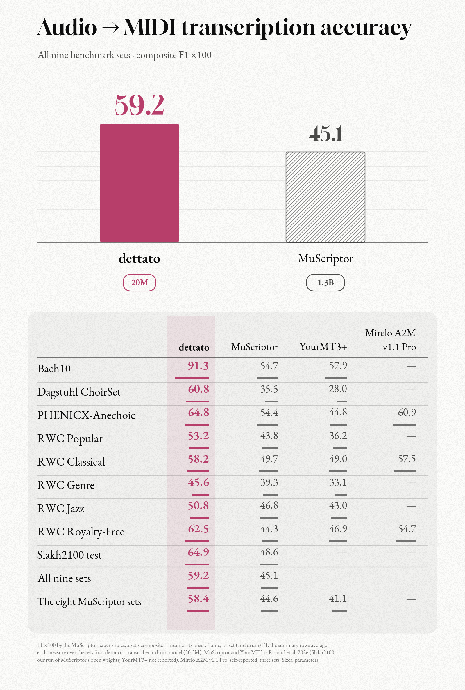
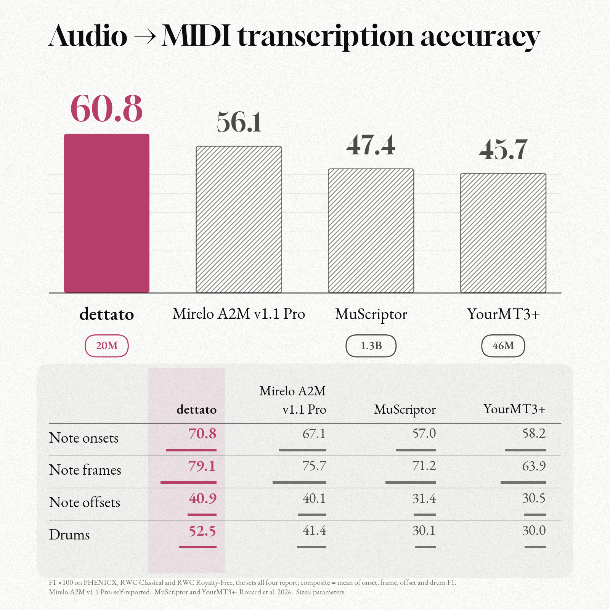
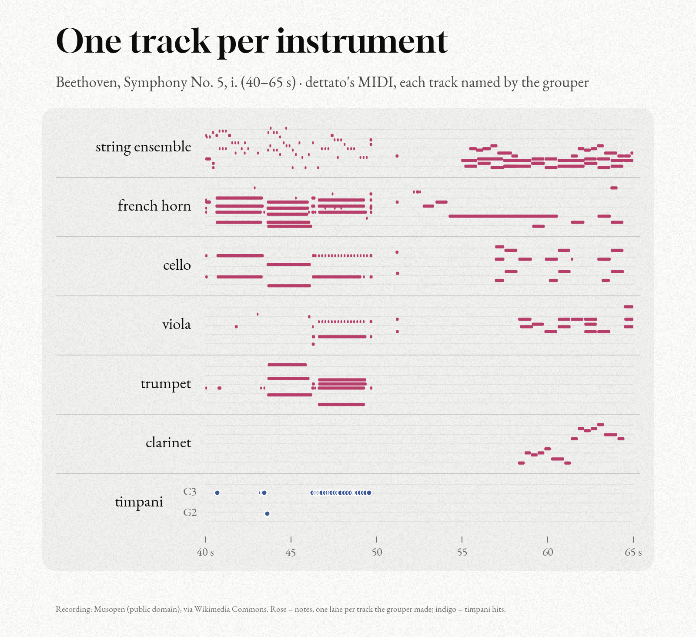
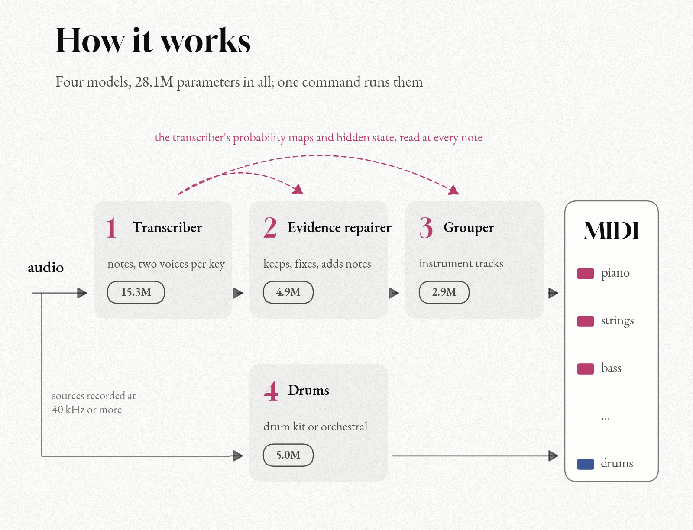

# Dettato

Dettato is KobiMusic's multi-instrument audio-to-MIDI transcriber. Give it any recording (a band, an orchestra, a jazz trio, a
pop song with vocals) and it writes a MIDI file with one track per instrument, each named after its instrument (73 classes, each
with a General MIDI program), plus a drum track that covers drum kits and orchestral percussion, with timpani written at their
pitch.



Nine public benchmark sets: the eight of the MuScriptor paper's Table 2 (Bach10, Dagstuhl ChoirSet, PHENICX-Anechoic, RWC
Popular, Classical, Genre, Jazz and Royalty-Free) plus Slakh2100 test, scored by that paper's rules. The composite is the mean of
note-onset, note-frame, note-offset and drum F1.

| system | parameters | composite | onset | frame | offset | drums |
|---|---|---|---|---|---|---|
| **Dettato transcriber + drums** | 20.3M | **59.2** (95% 57.9-60.6) | **67.2** | **77.9** | **44.8** | **47.1** |
| MuScriptor | 1.3B | 45.1 | 48.6 | 70.2 | 27.8 | 34.0 |

On the three sets Mirelo A2M v1.1 Pro reports (PHENICX-Anechoic, RWC Classical, RWC Royalty-Free), with all four systems: dettato
60.8, Mirelo A2M 56.1 (self-reported), MuScriptor 47.4, YourMT3+ 45.7.



On the eight MuScriptor sets alone: 58.4, against 44.6 for MuScriptor and 41.1 for YourMT3+ (the paper's numbers). Per-set tables
are on the [dettato](https://huggingface.co/kobimusic/dettato) and [dettato-drums](https://huggingface.co/kobimusic/dettato-drums)
cards.

What was measured: the table scores the transcriber's notes and the drum model's hits. The evidence repairer was measured on its own
(+0.30 composite with the transcriber's base network in front) and the grouper on an internal track benchmark; see their cards.
The four models chained as this package runs them have not been scored as one system yet.

## Install

```bash
pip install git+https://github.com/kobimusic/dettato
dettato song.mp3 -o out/        # -> out/song.mid + out/song.json
```

The weights download from the Hugging Face Hub on first use ([the Dettato collection](https://huggingface.co/collections/kobimusic/dettato)).



## Models

Four models, 28.1M parameters in all, collected in [kobimusic/Dettato](https://huggingface.co/collections/kobimusic/dettato). Each has its own model card:

| stage | model | parameters | what it does |
|---|---|---|---|
| 1 | [kobimusic/dettato](https://huggingface.co/kobimusic/dettato) | 15.3M | notes from audio: onset, end and pitch on 88 keys, two voices per key |
| 2 | [kobimusic/dettato-evidence](https://huggingface.co/kobimusic/dettato-evidence) | 4.9M | repairs the notes using the transcriber's own evidence: drops wrong notes, fixes onsets and ends, adds missed notes |
| 3 | [kobimusic/dettato-grouper](https://huggingface.co/kobimusic/dettato-grouper) | 2.9M | puts every note in an instrument track and names the instrument |
| 4 | [kobimusic/dettato-drums](https://huggingface.co/kobimusic/dettato-drums) | 5.0M | drum hits on General MIDI drum keys, drum kits and orchestral percussion |

## Use

### Command line

```bash
dettato song.mp3 other.wav folder/ -o out/
```

- Takes any number of files and folders (searched recursively; the folder structure is kept under `out/`).
- Writes `out/<name>.mid` and `out/<name>.json` (the tracks, note counts, the tuning estimate, which drum model ran).
- Uses the GPU when there is one (`--device cpu` to force the CPU).

### Python

```python
import dettato

result = dettato.transcribe("song.mp3")       # loads the models once, then reuses them
result.save_midi("song.mid")
for track in result.tracks:
    print(track.name, track.program, track.is_drum, len(track.notes))   # notes: (N, 4) onset s, end s, pitch, velocity
```

For many files, load once and keep the object:

```python
from dettato import Dettato

model = Dettato.from_pretrained("cuda")
for path in paths:
    model.transcribe(path).save_midi(path + ".mid")
```

Each stage can also be used on its own (`dettato.transcriber`, `dettato.evidence`, `dettato.grouper`, `dettato.drums`); the model
cards show how.

### Weights offline

Set `DETTATO_WEIGHTS` to a folder holding the four model repos (`dettato/`, `dettato-evidence/`, `dettato-grouper/`,
`dettato-drums/`, each with its `config.json` and `model.safetensors`) to load them from disk instead of the Hub.

## How it works



1. **Transcriber.** A pitch-equivariant lane network reads a harmonic log-frequency spectrogram and gives onset, frame and offset
   probabilities for every key, for two voices per key, at 20 ms. The song is processed in overlapping 8 s windows; notes come
   from peak picking.
2. **Evidence repairer.** A note-level transformer reads each note together with the transcriber's evidence for it (its probability
   maps around the note and its last hidden state) and decides which notes to keep, where they start and end, and which notes are
   missing.
3. **Grouper.** The recording's tuning is estimated and corrected, the transcriber's internal features are gathered at every
   repaired note, and a note-level transformer gives each note an instrument and a track embedding. Notes are clustered into
   tracks; a track is kept only when it is clearly its own instrument, and tracks with the same instrument are merged.
4. **Drums.** A small drum-kit model and an orchestral-percussion model; a router that listens to the whole recording picks one.
   The drum model needs audio recorded at 40 kHz or more and is skipped for lower-rate sources.

## Requirements

- Python 3.10+, PyTorch 2.2+. A CUDA GPU is recommended: on an RTX 5060 (8 GB) a 5-minute song takes about 40 s and peaks under
  4 GB of GPU memory, which grows with the song's length. The CPU works but is slow (a 15 s clip took 87 s on a laptop CPU,
  model loading included).
- Audio is read with `soundfile`; formats it cannot read (m4a / aac, some mp3s) go through `ffmpeg`, which must then be on the PATH.

## Limits

- Pitched notes cover the 88 piano keys; at most two notes on the same key at once.
- Instrument names are only roughly right: on real jazz about a quarter of a saxophone's or lead guitar's
  notes can land in the piano's track, synth-heavy music is named less reliably, and a concert band gets rough names.
- No drums for sources recorded below 40 kHz.

The example recordings in the figures are in the public domain: Beethoven's Symphony No. 5 and Grieg's Piano Concerto by Musopen
(via Wikimedia Commons) and *The Stars and Stripes Forever* by the United States Marine Band.

## Licence

Code and model weights: Apache-2.0 (see [LICENSE](LICENSE) and [NOTICE](NOTICE)). The model cards list the datasets each model was
trained with and their licences; some of the grouper's and the drum model's training datasets carry non-commercial terms.

## Citation

```bibtex
@software{dettato2026,
  title  = {Dettato: multi-instrument audio-to-MIDI transcription},
  author = {{KobiMusic}},
  year   = {2026},
  url    = {https://github.com/kobimusic/dettato}
}
```
